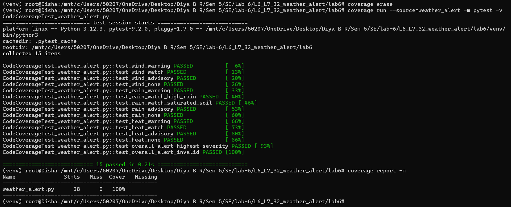
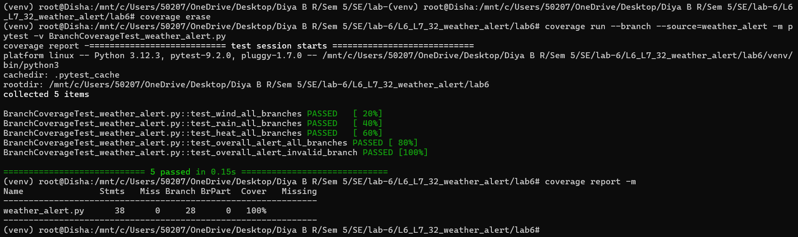

# Lab 6 – Code and Branch Coverage Testing

## Weather Alert Classifier

This project focuses on testing a Python-based Weather Alert Classifier using **pytest** and **coverage.py**. The objective is to understand code coverage and branch coverage by developing test cases that exercise the different conditions and execution paths in the application.

## Project Overview

The Weather Alert Classifier evaluates weather conditions and assigns alert levels based on wind speed, rainfall, soil saturation, temperature, and humidity.

The application supports four alert levels:

- `none`
- `advisory`
- `watch`
- `warning`

It also determines the overall alert severity from a collection of individual alerts.

## Application Functions

| Function | Description |
|---|---|
| `wind_alert()` | Determines alert severity based on wind speed. |
| `rain_alert()` | Determines alert severity based on rainfall and soil saturation. |
| `heat_alert()` | Determines alert severity based on temperature and humidity. |
| `overall_alert()` | Returns the highest severity among the supplied alerts and handles invalid alert values. |

## Technologies Used

- Python 3
- pytest – Automated testing framework
- coverage.py – Code and branch coverage measurement

## Project Structure

```text
lab6/
├── weather_alert.py
├── test_weather_alert.py
├── CodeCoverageTest_weather_alert.py
├── BranchCoverageTest_weather_alert.py
├── CodeCoverage_weather_alert.png
├── BranchCoverage_weather_alert.png
├── README.md
└── .gitignore
```

## Test Implementation

Two separate test suites were created.

### 1. Code Coverage Testing

`CodeCoverageTest_weather_alert.py`

Test cases cover the different functions, alert thresholds, valid inputs, and invalid alert handling.

Command:

```bash
coverage erase
coverage run --source=weather_alert -m pytest -v CodeCoverageTest_weather_alert.py
coverage report -m
```

**Result: 100% Code Coverage**



### 2. Branch Coverage Testing

`BranchCoverageTest_weather_alert.py`

Test cases exercise both outcomes of conditional statements, including wind thresholds, rainfall conditions, humidity conditions, severity comparisons, and invalid alert handling.

Command:

```bash
coverage erase
coverage run --branch --source=weather_alert -m pytest -v BranchCoverageTest_weather_alert.py
coverage report -m
```

**Result: 100% Branch Coverage**



## Coverage Results

| Coverage Metric | Achieved |
|---|---:|
| Code Coverage | 100% |
| Branch Coverage | 100% |

All statements and branches in `weather_alert.py` were successfully covered by the respective test suites.

## How to Run the Project

### 1. Clone the repository

```bash
git clone https://github.com/Diya-BR/lab-6-weather-alert.git
cd lab-6-weather-alert/lab6
```

### 2. Install dependencies

```bash
python -m pip install pytest coverage
```

### 3. Run code coverage tests

```bash
coverage erase
coverage run --source=weather_alert -m pytest -v CodeCoverageTest_weather_alert.py
coverage report -m
```

### 4. Run branch coverage tests

```bash
coverage erase
coverage run --branch --source=weather_alert -m pytest -v BranchCoverageTest_weather_alert.py
coverage report -m
```

## Conclusion

This lab demonstrates how automated testing can be used to measure the effectiveness of test cases. Separate test suites were developed for code coverage and branch coverage, achieving **100% coverage in both metrics** for the Weather Alert Classifier.
